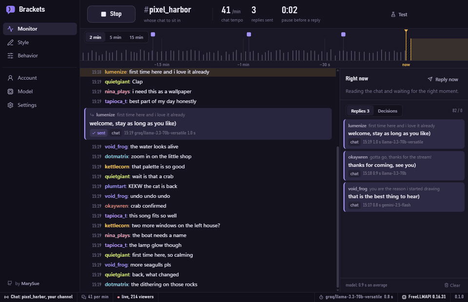
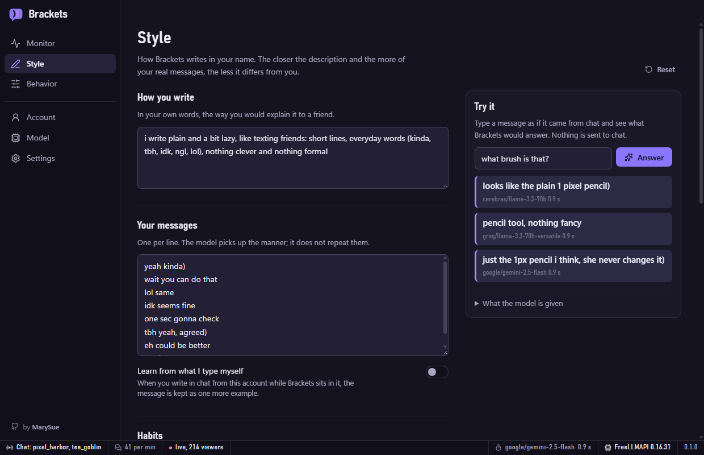
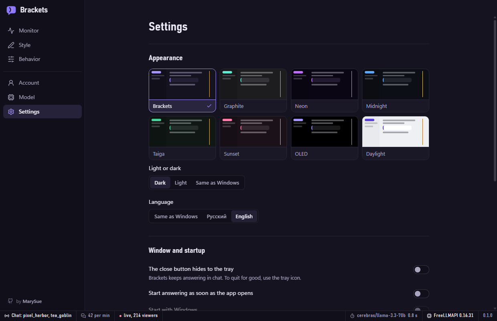
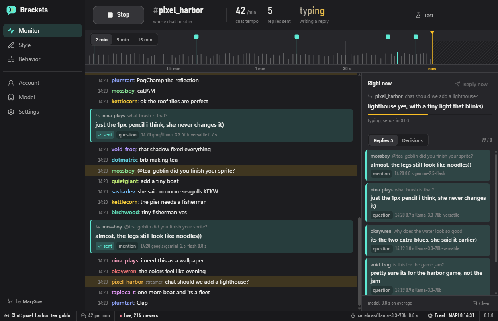
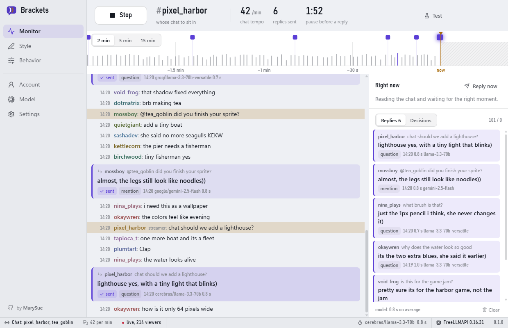
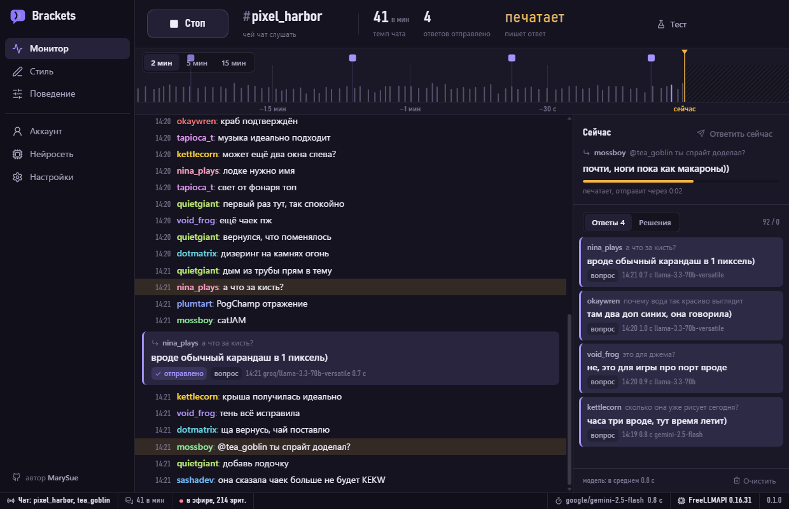

# Brackets — Twitch chat bot

Brackets sits in a Twitch chat under your account and answers some of the messages the way you would write them. Its launcher shows the chat, every reply, and why a message did or did not get one.

<p align="center">
  
</p>

**Author:** [MarySue](https://github.com/MarySueXLsD) · more of my projects on [itch.io](https://marysue.itch.io)

The replies are written by a language model through [FreeLLMAPI](https://github.com/tashfeenahmed/freellmapi), which is built into the app. It works without any API key; a free key from Groq or Google makes it faster.

The name comes from the closing bracket some people end a message with in place of a smiley: "ну да)". Brackets can write that way too.

## What it does

- **Answers now and then, not every message.** After each reply it pauses for a random time, then answers one of the next messages. Four paces from "rarely" to "full on", or your own numbers.
- **Answers sooner when someone talks to you**, and more readily to questions, to the streamer and to topics you list.
- **Writes like you.** You describe your manner and paste real messages of yours; it can also learn from what you type in chat yourself. The bracket at the end is added by the app, so it is there even when the model forgets.
- **Types at a human speed** and drops a reply that would arrive too late.
- **A monitor.** The chat, the replies, the reasons, and a rhythm strip that draws the chat like a step sequencer: a tick per message, a lit pad per reply, a playhead for now, and the pause after a reply hatched ahead of it.
- **Test mode.** Replies are written and shown but not sent. Without a Twitch sign-in the app runs this way against any chat, as a guest.
- **Works in the background.** Closing the window leaves it in the tray.
- English and Russian interface, eight themes.

What it will not do:

- **It never sees your Twitch password.** You sign in on Twitch's own page with a short code.
- **It does not send links, commands or @mentions** the model made up, and it drops replies where a model answers like an assistant or thinks out loud.
- **It does not answer "are you a bot?"** A made-up "no" would be a lie told in your name. It stays silent, flags the message, and leaves the answer to you.
- **It skips** bots, commands, chants and other people's conversations, goes quiet for a few minutes when you type yourself, and stops when the account is timed out or banned.

## Screenshots

The pictures use the built-in demo: a made-up stream with invented viewers and scripted answers.

| | |
| --- | --- |
|  |  |
| The monitor: a reply being typed, earlier replies on the right | Why one message got an answer and another did not |
|  |  |
| Your manner, and a box to try it without sending anything | Four paces, shown with the pause each one takes |
|  |  |
| Signing in with a code; no password is typed anywhere | FreeLLMAPI runs inside the app; keys are optional |
|  |  |
| Eight themes | Graphite |
|  |  |
| Neon | Daylight |
|  |  |
| First start: what is ready and what is missing | The same screen in Russian |

## Run it from source

You need Node.js 22 or newer and git.

```bash
npm install
```

```bash
npx install-electron
```

```bash
npm run setup
```

```bash
npm run dev
```

`npm run setup` fetches FreeLLMAPI at a pinned commit into `vendor/`, bundles its server into `out/router/` and draws the icons. It is needed once, and again after changing the FreeLLMAPI version.

Build the Windows installer (`release/Brackets-Setup-<version>.exe`):

```bash
npm run dist
```

The installer is not code-signed, so Windows shows "Windows protected your PC" once: **More info → Run anyway**.

### The demo

To see the app at work without Twitch, an account or a model, run it on the demo chat. `npm install` and `npx install-electron` are enough for this; it keeps its settings in a folder of its own.

```bash
npm run demo
```

## Signing in to Twitch

Twitch chat accepts access tokens, not passwords, so the app has no place to type one.

1. Register an application once at [dev.twitch.tv/console/apps](https://dev.twitch.tv/console/apps). Name: anything without the word Twitch. OAuth Redirect URL: `http://localhost`. Category: Chat Bot. Client Type: **Public**. Any Twitch account with two-factor protection can do this; it does not have to be the account that will chat.
2. Copy the application's Client ID. Paste it on the **Account** page. To build it into a copy you hand to someone, put it on one line in `twitch-client-id.local.txt` next to `package.json` before building; that file is not committed. A Client ID is not a secret.
3. On the Account page press **Sign in with Twitch**. The app shows a code and opens twitch.tv/activate; the owner of the account enters the code there, in their own browser.

The token may read and write chat and nothing else. It is stored encrypted for the current Windows user and renews itself.

## How a reply happens

1. **Is this message for answering at all?** Bots, commands, links, votes like "+1", chants and messages addressed to someone else are passed over.
2. **Is it time?** After a reply there is a pause. Once it ends, each message gets a chance sized so that a reply lands within about twenty seconds, however fast the chat is. A question, the streamer or a favourite topic gets a bigger chance; your name skips the pause.
3. **Write it.** The model gets your style, the last messages and the one to answer.
4. **Clean it.** One line, your capitals and punctuation habits, no links or commands, nothing that reads like an assistant.
5. **Type it.** The app waits as long as a person would need to read the message and type the answer, and gives up if that makes the reply stale.

`src/core/` holds these rules; they have no network or clock in them and are covered by `tests/`.

## FreeLLMAPI

The router is FreeLLMAPI's own server, unchanged, started as a separate process on `127.0.0.1` only. Its database runs on Node's built-in SQLite, so nothing native is compiled. **Model → Open the dashboard** shows FreeLLMAPI's full dashboard, signed in.

The version is pinned in `scripts/vendor.config.mjs` by tag and commit. To update, change both, run `npm run setup`, compare `router/host.ts` with `desktop/src/server-host.ts` in the new FreeLLMAPI checkout, and run the smoke test below.

FreeLLMAPI keeps its model list fresh from freellmapi.co and sends each request to the provider that answers it. A request holds the last few chat messages and your style description.

## Checking it

```bash
npm test
```

```bash
npm run typecheck
```

Start the bundled router alone and send it one request:

```bash
node scripts/smoke-router.mjs --chat --wait=20
```

The pictures and the GIF on this page are made by the app itself. `src/main/shots.ts` and `scripts/make-preview.mjs` say how.

## Where things are

| Path | What is in it |
| --- | --- |
| `src/core/irc.ts` | Reading and writing Twitch chat lines |
| `src/core/pacer.ts` | When to reply |
| `src/core/persona.ts` | The instructions for the model |
| `src/core/filters.ts` | Turning model output into a chat line, or refusing it |
| `src/main/bot.ts` | The responder: ties the four together |
| `src/main/twitch/` | The chat connection and the sign-in |
| `src/main/router.ts`, `router/host.ts` | Running FreeLLMAPI |
| `src/main/store.ts` | Settings and encrypted secrets |
| `src/main/demo.ts` | The demo chat |
| `src/renderer/` | The launcher window |
| `src/shared/` | Types, defaults and themes shared by both sides |
| `tests/` | Unit tests for `src/core` |

Settings, the sign-in and the router's database live in `%APPDATA%\Brackets Twitch Chat Bot`.

## Before you switch it on

Automatic replies under a personal account are not welcome in every chat, and a streamer or moderator may time out an account for them. Use test mode first, start with a slow pace, and do not run it where the channel does not want it.

## Credits

- [FreeLLMAPI](https://github.com/tashfeenahmed/freellmapi) by Tashfeen Ahmed, MIT licence. Its licence text ships with the app in `FreeLLMAPI-LICENSE.txt`.
- The look follows my other two apps, [Maris](https://github.com/MarySueXLsD/Maris-Local-AI) and [SensePad](https://github.com/MarySueXLsD/SensePad).
- Twitch is a trademark of Twitch Interactive. Brackets is not affiliated with Twitch.
