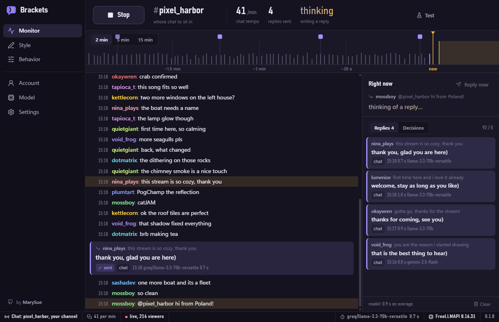
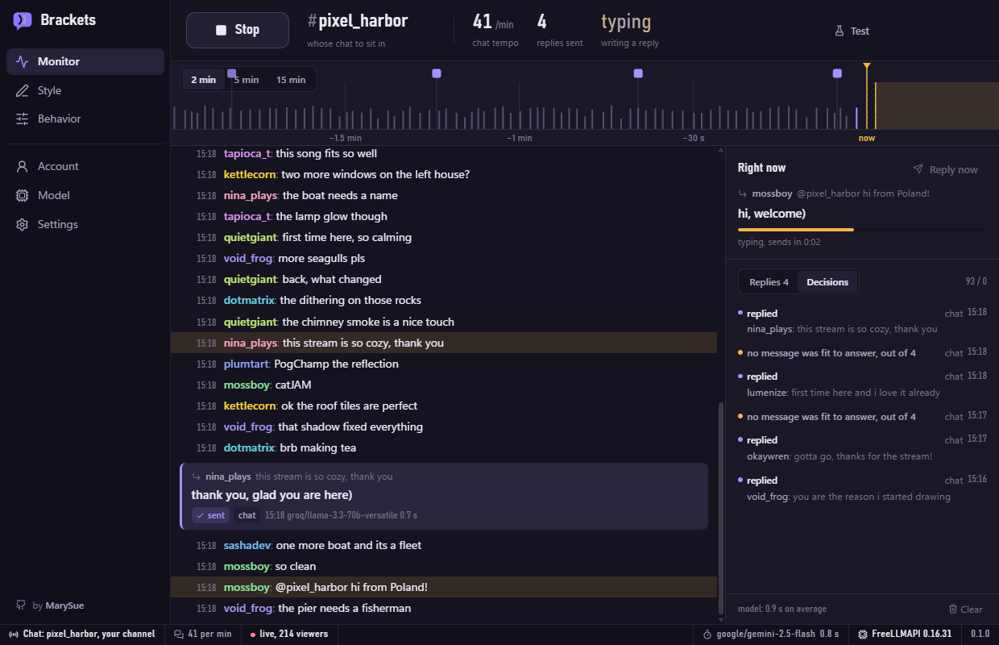
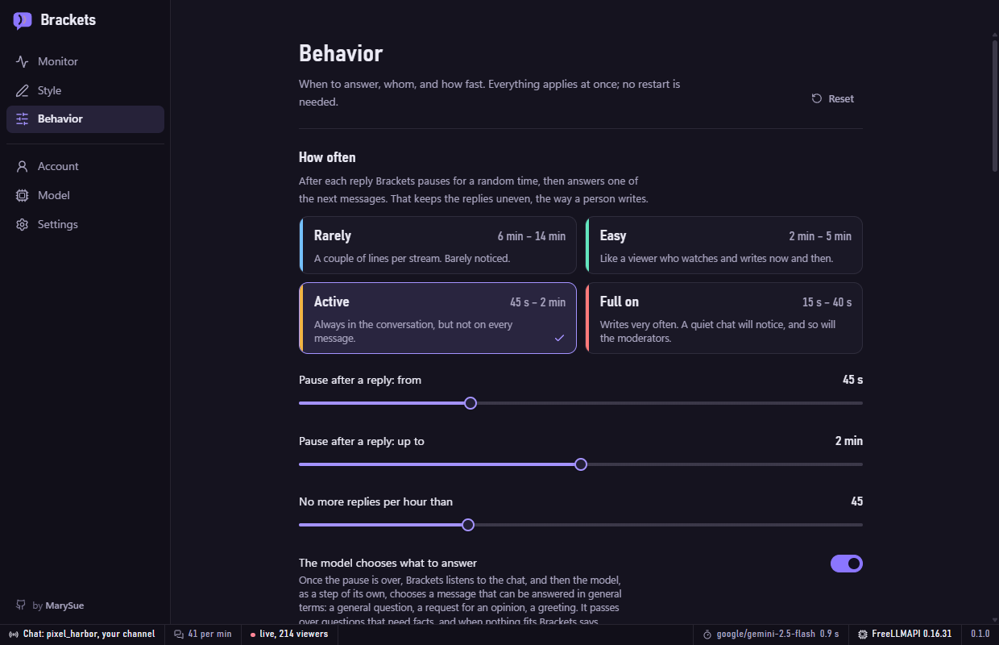
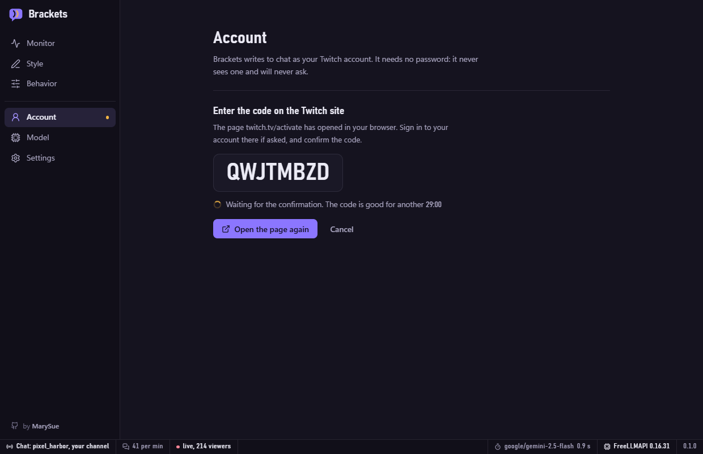
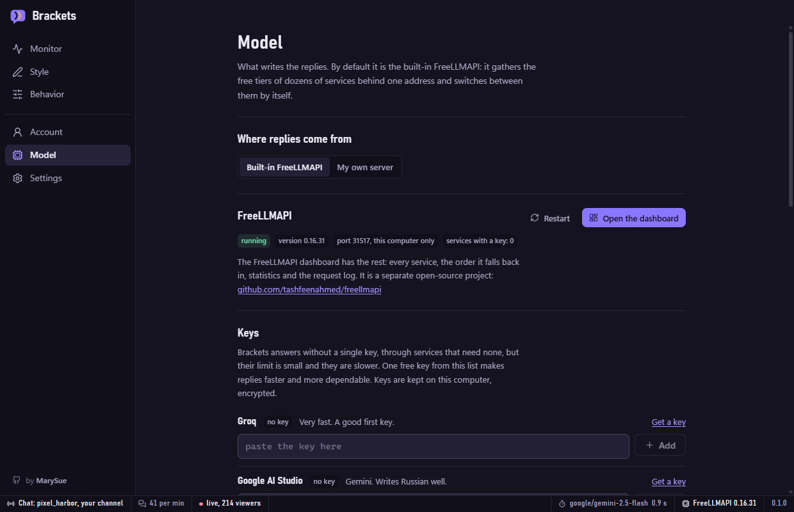
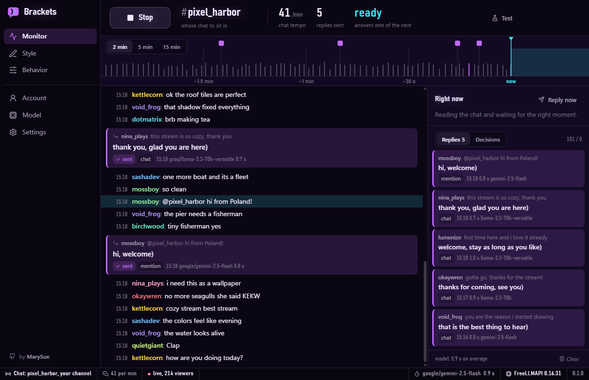
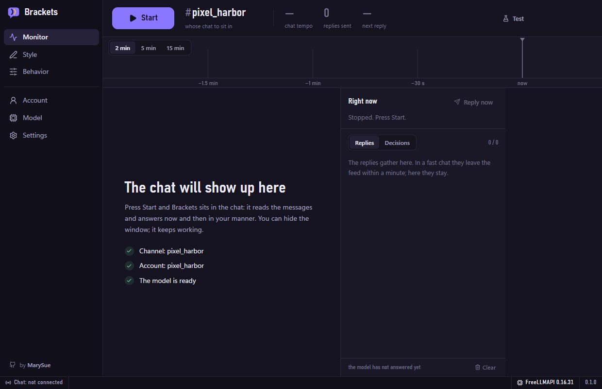

# Brackets — Twitch chat bot

Brackets answers your viewers in your own Twitch chat while you play, from your account and in your manner: "great stream" gets a "thanks)" or a joke, a hello gets a hello back. Its launcher shows the chat, every reply, and why a message did or did not get one.

<p align="center">
  
</p>

**Author:** [MarySue](https://github.com/MarySueXLsD) · more of my projects on [itch.io](https://marysue.itch.io)

**[Download Brackets for Windows](https://github.com/MarySueXLsD/Brackets-Twitch-Chat-Bot/releases/latest)**

The replies are written by a language model through [FreeLLMAPI](https://github.com/tashfeenahmed/freellmapi), which is built into the app. It works without any API key; a free key from Groq or Google makes it much faster and steadier.

The name comes from the closing bracket some people end a message with in place of a smiley: "спасибо)". Brackets can write that way too.

## What it does

- **Chooses what to answer, then answers.** These are two separate jobs for the model. First it looks over the latest messages for one you could answer without checking anything: praise, a hello or a goodbye, "how are you", a joke. Only then does it write the reply. Often the right choice is "none of these", and then it says nothing.
- **Answers in general terms and makes nothing up.** It cannot see your stream, only the chat, so it states no facts about the game, your setup or what just happened. A question that needs one is passed over.
- **Promises nothing in your name.** Requests for giveaways, moderator rights, gifts or dates are not answered.
- **Not every message.** After each reply it pauses for a random time. Four paces from "rarely" to "full on", or your own numbers. Your name in a message is answered sooner.
- **Writes like you.** You describe your manner and paste real messages of yours; it can also learn from what you type in chat yourself. The bracket at the end is added by the app, so it is there even when the model forgets.
- **Types at a human speed** and drops a reply that would arrive too late.
- **A monitor.** The chat, the replies, the reasons, and a rhythm strip that draws the chat like a step sequencer: a tick per message, a lit pad per reply, a playhead for now, and the pause after a reply hatched ahead of it.
- **Test mode.** Replies are written and shown but not sent. Without a Twitch sign-in the app runs this way against any chat, as a guest.
- **Works in the background.** Closing the window leaves it in the tray.
- English and Russian interface, eight themes.

It can also sit in someone else's chat as one of the viewers; it tells which by whose channel it is, and there is a switch on the Style page.

What it will not do:

- **It never sees your Twitch password.** You sign in on Twitch's own page with a short code.
- **It does not send links, commands or @mentions** the model made up, and it drops replies where a model answers like an assistant or thinks out loud.
- **It does not answer "are you a bot?"** A made-up "no" would be a lie told in your name. It stays silent, flags the message, and leaves the answer to you.
- **It skips** bots, commands, chants and viewers talking to each other, goes quiet for a few minutes when you type yourself, and stops when the account is timed out or banned.

## Screenshots

The pictures use the built-in demo: a made-up stream with invented viewers and scripted answers.

| | |
| --- | --- |
|  |  |
| The monitor: a reply being written, earlier replies on the right | What was answered, and when nothing in the chat was fit to answer |
|  |  |
| Your manner, and a box to try it without sending anything | Four paces, shown with the pause each one takes |
|  |  |
| Signing in with a code; no password is typed anywhere | FreeLLMAPI runs inside the app; keys are optional |
|  |  |
| Eight themes | Graphite |
|  |  |
| Neon | Daylight |
|  |  |
| First start: what is ready and what is missing | The same screen in Russian |

## Install

1. Download `Brackets-Setup-<version>.exe` from the [latest release](https://github.com/MarySueXLsD/Brackets-Twitch-Chat-Bot/releases/latest) and run it. Windows 10 or 11, 64-bit.
2. Windows shows "Windows protected your PC" once, because the installer has no paid code signature: **More info → Run anyway**.
3. Type your channel next to **Start** and press it. Without a sign-in this is test mode: you see what it would answer, and nothing is sent.
4. To let it answer for real, sign in on the **Account** page (below).

## Signing in to Twitch

Twitch chat accepts access tokens, not passwords, so the app has no place to type one.

1. Register an application once at [dev.twitch.tv/console/apps](https://dev.twitch.tv/console/apps). Name: anything without the word Twitch. OAuth Redirect URL: `http://localhost`. Category: Chat Bot. Client Type: **Public**. Any Twitch account with two-factor protection can do this.
2. Copy the application's Client ID and paste it on the **Account** page. A Client ID is not a secret.
3. Press **Sign in with Twitch**. The app shows a code and opens twitch.tv/activate; enter the code there, in your own browser.

The token may read and write chat and nothing else. It is stored encrypted for the current Windows user and renews itself.

To build a Client ID into a copy you hand to someone, put it on one line in `twitch-client-id.local.txt` next to `package.json` before building; that file is not committed.

## How a reply happens

1. **Listen.** When the pause after the last reply is over, the app gathers the messages that could be answered at all. Bots, commands, links, votes like "+1", chants and messages between viewers are left out.
2. **Choose.** The model is shown those messages and asked for one that can be answered in general terms, or for "none". When it finds none, the app waits longer before asking again.
3. **Write.** The model gets your style, the last messages and the one it chose, with the rules above: general, nothing made up, nothing promised. It may still answer "skip".
4. **Clean.** One line, your capitals and punctuation habits, no links or commands, nothing that reads like an assistant, a classifier's verdict or a model reasoning aloud.
5. **Type.** The app waits as long as a person would need to type the answer, and gives up if that makes the reply stale.

A message with your name in it skips the first two steps. With "the model chooses" switched off on the Behavior page, step 2 is a roll of the dice instead.

`src/core/` holds these rules; they have no network or clock in them and are covered by `tests/`.

## The model

The router is FreeLLMAPI's own server, unchanged, started as a separate process on `127.0.0.1` only. Its database runs on Node's built-in SQLite, so nothing native is compiled. **Model → Open the dashboard** shows FreeLLMAPI's full dashboard, signed in.

Without a key, replies come from the free services that need none. Those are slow (several seconds a reply) and about one answer in four is unusable: the model thinks out loud instead of answering. Brackets drops those, so it replies less often than the pace you set. One free key from Groq or Google, added on the **Model** page, fixes most of that.

Brackets switches off the "guard" models in the router: they are classifiers listed among the chat models, and they answer every request with a verdict such as "Safety: Safe".

The FreeLLMAPI version is pinned in `scripts/vendor.config.mjs` by tag and commit. To update, change both, run `npm run setup`, compare `router/host.ts` with `desktop/src/server-host.ts` in the new FreeLLMAPI checkout, and run the smoke test below.

FreeLLMAPI keeps its model list fresh from freellmapi.co and sends each request to the provider that answers it. A request holds the last few chat messages and your style description.

## Run it from source

You need Node.js 22 or newer and git.

```bash
npm install
```

```bash
npx install-electron
```

```bash
npm run setup
```

```bash
npm run dev
```

`npm run setup` fetches FreeLLMAPI at a pinned commit into `vendor/`, bundles its server into `out/router/` and draws the icons. It is needed once, and again after changing the FreeLLMAPI version.

Build the Windows installer (`release/Brackets-Setup-<version>.exe`):

```bash
npm run dist
```

### The demo

To see the app at work without Twitch, an account or a model, run it on the demo chat. `npm install` and `npx install-electron` are enough for this; it keeps its settings in a folder of its own.

```bash
npm run demo
```

## Checking it

```bash
npm test
```

```bash
npm run typecheck
```

Start the bundled router alone and send it one request:

```bash
node scripts/smoke-router.mjs --chat --wait=20
```

The pictures and the GIF on this page are made by the app itself. `src/main/shots.ts` and `scripts/make-preview.mjs` say how.

## Where things are

| Path | What is in it |
| --- | --- |
| `src/core/irc.ts` | Reading and writing Twitch chat lines |
| `src/core/pacer.ts` | When a reply may happen |
| `src/core/picker.ts` | The model's first job: choosing the message |
| `src/core/persona.ts` | The model's second job: the instructions for the reply |
| `src/core/filters.ts` | Turning model output into a chat line, or refusing it |
| `src/main/bot.ts` | The responder: ties these together |
| `src/main/twitch/` | The chat connection and the sign-in |
| `src/main/router.ts`, `router/host.ts` | Running FreeLLMAPI |
| `src/main/store.ts` | Settings and encrypted secrets |
| `src/main/demo.ts` | The demo chat |
| `src/renderer/` | The launcher window |
| `src/shared/` | Types, defaults and themes shared by both sides |
| `tests/` | Unit tests for `src/core` |

Settings, the sign-in and the router's database live in `%APPDATA%\Brackets Twitch Chat Bot`.

## Before you switch it on

On your own channel this is your call. In someone else's chat, automatic replies under a personal account are not always welcome, and a streamer or moderator may time out an account for them: use test mode first, start with a slow pace, and do not run it where the channel does not want it.

## Licence and credits

Brackets is released under the [MIT licence](LICENSE).

- [FreeLLMAPI](https://github.com/tashfeenahmed/freellmapi) by Tashfeen Ahmed, MIT licence. Its licence text ships with the app in `FreeLLMAPI-LICENSE.txt`.
- The look follows my other two apps, [Maris](https://github.com/MarySueXLsD/Maris-Local-AI) and [SensePad](https://github.com/MarySueXLsD/SensePad).
- Twitch is a trademark of Twitch Interactive. Brackets is not affiliated with Twitch.
